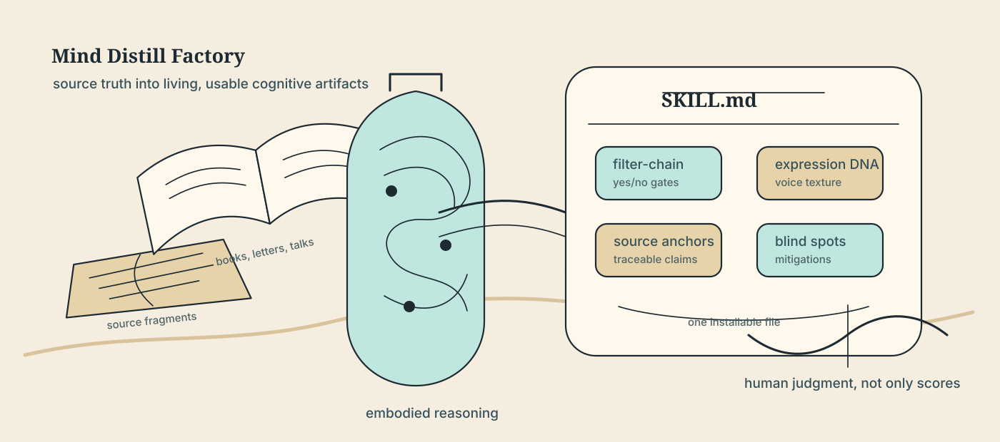
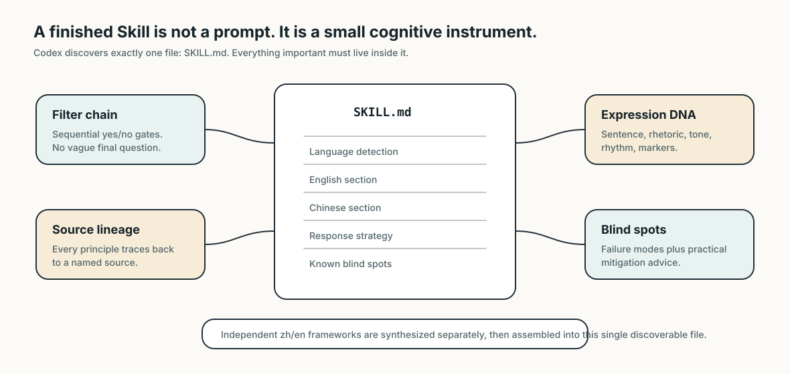
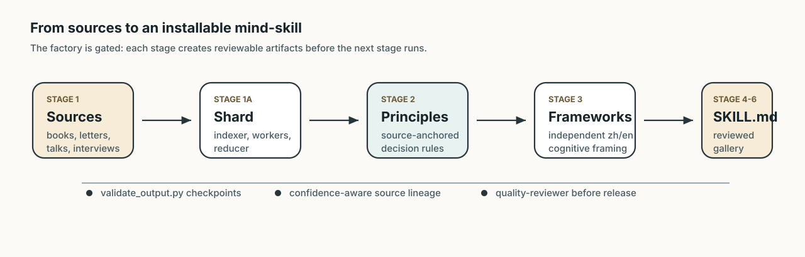
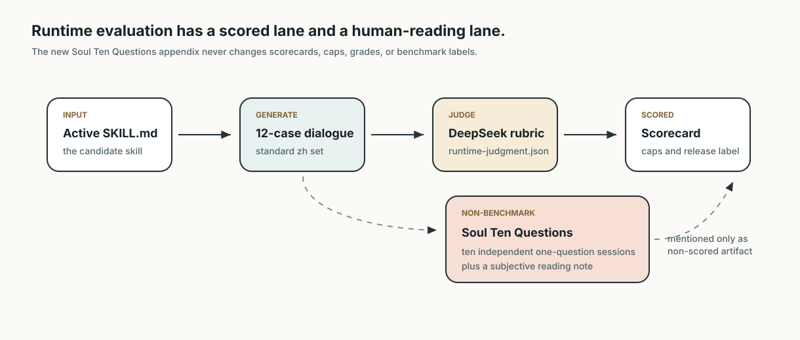
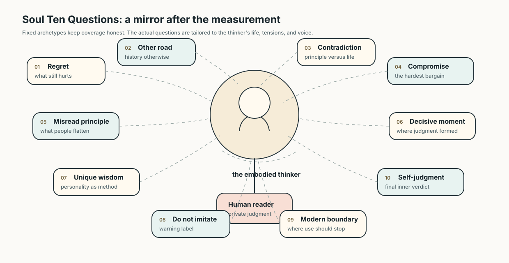

# Mind Distill Factory

<p align="center">
  
</p>

Mind Distill Factory turns the sources, judgment habits, expressive texture, value orientation, and failure modes of important thinkers into installable **Codex Skills**.

It is not a quote collection. It is not a biography generator. It is not theatrical roleplay. The goal is to build a small cognitive instrument: a Skill package that can respond from inside a thinker's way of seeing while remaining source-traceable, practically useful, and honest about its own limits.

[中文说明](README.zh.md) · [Main README](README.md)

## The Idea

Most persona prompts imitate the surface: a few famous phrases, a tone label, and a list of slogans. That breaks quickly when a user asks a difficult second question.

Mind Distill Factory treats a thinker as a method under pressure. It asks:

- What did this person notice that others tended to miss?
- Which principles were used when the stakes were real?
- How did the life contradict, distort, or deepen the doctrine?
- Where should a modern user borrow the method, and where should they stop?

A good Skill should feel less like reading a report about a thinker and more like entering a disciplined conversation with a reconstructed mind.

## What A Skill Contains

<p align="center">
  
</p>

Skill discovery looks for exactly one file named `SKILL.md` per skill directory. Files such as `SKILL.zh.md` or `README.md` are invisible to the loader, but a skill directory may also hold sub-files that the model reads on demand through relative paths written into `SKILL.md`. Format v6 uses that: a distilled Skill ships as a **package**.

```text
{slug}-wisdom/
├── SKILL.md              # always loaded: Chinese-only, format_version: 6, self-sufficient, ≤500 lines
└── references/           # read on demand
    ├── cases.md          # worked cases, ≥2 per principle cluster, ≥1 counter-case
    ├── evidence.md       # verbatim source excerpts, machine-checked against the corpus
    └── voice.md          # ≥20 annotated voice samples
```

`SKILL.md` is never a dispatcher: deleting `references/` must still leave a complete, working framework (gate P6). The case *index* lives in `SKILL.md`, so the model always knows what exists; only case bodies live in `references/cases.md`. A human-readable dossier, `人物档案.md`, is written to `output/` and `gallery/` but is never copied into the install directory, because a third-person dossier inside the skill would pull the voice out of first person.

**Chinese is the default and only language of the v6 package.** There is no `## English` block and no language-detection header. After the Chinese package is installed, `/distill` asks whether to also build an English version. Only on a yes does it run the English branch: it reuses the language-neutral `framework_core.json`, reconstructs the English framework independently (not a translation of the Chinese one), and publishes it as a **separate** skill directory, `{slug}-wisdom-en`. That English Skill is currently a legacy-format single file: it has no `references/` and does not go through gates P1–P6.

The table below lists what the Chinese core contains.

| Component | Purpose |
| --- | --- |
| Filter-chain decision framework | Sequential yes/no gates that make the thinker usable in real decisions. |
| Core principles | Source-anchored rules with modern scenarios and outcome logic. |
| Reasoning patterns | Characteristic cognitive moves: triggers, mental operations, and historical examples. |
| Expression DNA | Eight dimensions of voice: sentence patterns, rhetoric, tone, certainty, humor, taboos, paragraph rhythm, and conversational markers. |
| Structural naturalness rules | Instructions that prevent template-shaped AI answers and preserve uneven, human-like response shape. |
| Values and anti-patterns | What the thinker pursues, rejects, and leaves unresolved. |
| Blind spots with mitigation | Failure modes, when not to use the Skill, and how to counterbalance it. |
| Source lineage | Confidence-aware attribution. First-hand user materials can be high confidence; web-only quotes are capped. |

## Pipeline

<p align="center">
  
</p>

The pipeline is gated because a beautiful answer is not enough. Each stage produces reviewable artifacts, and `scripts/validate_output.py` enforces structural checks between stages.

1. Clarify the thinker, slug, taxonomy category, and source availability.
2. Collect primary and secondary sources, including user-provided local files when present.
3. Index large local corpora, then process them through bounded worker batches and a reducer.
4. Extract principles, quotes, reasoning patterns, blind spots, and evidence anchors.
5. Build a language-neutral framework core, then synthesize the Chinese framework from it.
6. Assemble the Chinese `SKILL.md` core, then generate `references/` and the dossier.
7. Pass the package gates (P1–P6), quality review, publish to `gallery/`, and install.
8. Optionally build the separate English Skill `{slug}-wisdom-en`.

The stable local-source contract is:

```text
sources/{slug}/raw/                 # source files supplied by the user
sources/{slug}/processed/           # structured intermediate artifacts
sources/{slug}/processed/user_sources.json
```

### Local Source Pipeline

Full details live in [sources/README.md](sources/README.md). In short:

- **Source registry.** Indexing (`python scripts/local_source_pipeline.py index <slug>`) accepts `.txt`, `.md`, `.markdown`, and `.pdf`, including nested folders, and writes `processed/source_registry.json`, binding each file to its path, media type, size, SHA-256, role, origin, rights status, and duplicates.
- **PDF page classification.** Each PDF page and document is classified as pure text, mixed text/image, pure image, or empty/unreadable. Only information-rich image pages, or pages with poor text quality, become OCR candidates. Native text and OCR text are kept as separate provenance layers.
- **Optional extras.** PDF and OCR backends are opt-in `pyproject.toml` extras: `pdf` (PyMuPDF, pypdf), `ocr` (RapidOCR, CPU default), and `ocr-high-accuracy` (PaddleOCR escalation).

  ```powershell
  pip install -e ".[pdf,ocr]"
  ```

- **Deterministic sampling.** Large corpora get a `sampling_plan.json` with a stable seed, strata, selected units, token coverage, and omitted strata, plus a `dispatch_plan.json` of bounded worker batches.
- **Budget gate.** `cost_estimate.json` gives token, request, and OCR-page ranges (or `cost_unknown` when pricing is not configured; it never invents a currency amount). If the upper bound exceeds the configured budget, the orchestrator must ask whether to process exhaustively, sample, reduce scope, or cancel **before** any expensive LLM workers or network supplementation start.

### Artifact Flow

| Stage | Question | Typical artifacts |
| --- | --- | --- |
| Stage 0 | Who is being distilled, and what kind of wisdom is this? | slug, taxonomy category, source plan |
| Stage 1 | Are the materials reliable enough? | primary and secondary source findings, quote candidates |
| Stage 1A | How do we process a large local corpus without overloading one context? | source registry, shard manifest, sampling/dispatch plans, cost estimate, worker outputs, `user_sources.json` |
| Stage 2 | Which claims are executable judgment rules? | principles, reasoning patterns, quotes, blind spots |
| Stage 3 | How do the evidence anchors become a full cognitive framework? | `framework_core.json`, `frameworks.zh.json` |
| Stage 4 | Is the always-loaded core complete on its own? | Chinese `SKILL.md` (`format_version: 6`) |
| Stage 4.5 | Are the on-demand attachments built and indexed? | `references/{cases,evidence,voice}.md`, `人物档案.md`; package gates P1–P6 |
| Stage 5 | Does it sound, reason, and self-limit correctly? | quality review and repair notes |
| Stage 6 | Is the released copy the same artifact that passed review? | `gallery/{slug}/` package, `gallery/index.json`, install |
| Stage 6.5 | Does the user want an English version? (opt-in) | `frameworks.en.json`, separate `{slug}-wisdom-en` Skill |

This makes repair local. If the voice is strong but evidence is weak, return to Stage 2. If evidence is good but output shape is formulaic, repair Stage 4 or Stage 5. If a package gate fails, repair the attachment or index it names. If the English branch feels cognitively mismatched with the Chinese one, rebuild it from the shared core rather than translating one into the other.

## Anti-Formula Design

The factory is built against a specific failure: AI tends to flatten every thinker into a neat, polite, consulting-style answer. Mind Distill Factory uses several mechanisms to resist that.

First-person immersion means the Skill should not constantly say "Munger believed" or "Sun Tzu would advise." It should answer from the thinker's method, while staying within documented boundaries.

Expression DNA forces specificity. "Analytical," "strategic," and "direct" are not enough. The Skill must capture sentence shape, rhetorical habits, baseline tone, certainty, humor, taboos, paragraph rhythm, and conversational markers.

Structural naturalness prevents every response from becoming four balanced sections with equal-length paragraphs. The Skill is instructed to vary length, break symmetry, adapt depth to the prompt, and allow less polished transitions when that better fits the voice.

Constructive value orientation keeps the output useful. When a user brings grievance, failure, or unfairness, the Skill may acknowledge reality, but it should move toward agency, repair, discipline, or action instead of staying in complaint.

## Resemblance Is Not Enough

A Skill can sound like a thinker and still be weak. It may imitate catchphrases while failing to reason. It may quote accurately while being unable to handle a modern case. The factory therefore evaluates three layers:

| Layer | What it checks |
| --- | --- |
| Evidence | Whether the advice traces back to sources rather than invented authority. |
| Method | Whether new answers use the thinker's distinctive judgment moves. |
| Personhood | Whether rhythm, hesitation, force, restraint, and limits form a credible presence. |

The reviewer should ask hard questions. Could this paragraph be attributed to any generic productivity writer? Is the answer only an encyclopedia summary? Did the thinker's pain, hesitation, force, misjudgment, or unresolved tension actually enter the artifact? If not, the Skill is still a shell.

## Quality Gates

Before a Skill enters `gallery/`, it must pass checks for:

| Gate | Requirement |
| --- | --- |
| Source traceability | Principles and quotes point to named materials. Web-only quotes cannot be high confidence. |
| Uniqueness | The method must survive a de-name test, evidence-anchor test, and methodology-level test. |
| Decision framework | Steps must be filter-type yes/no gates, not open-ended prompts. |
| Package gates | `validate_output.py package` passes P1–P6 (see Usage). |
| Bilingual cognition | Only when the English branch was requested: the `-wisdom-en` Skill is independently framed, not mechanically translated, and reviewed for cultural-cognitive accuracy. |
| Blind spots | Each failure mode includes mitigation advice and "when not to use" guidance. |
| Expression DNA | The voice profile must distinguish this thinker from generic analytical prose. |
| Structural naturalness | Anti-template response-shape rules must be present and complete. |
| Values and anti-patterns | At least two pursued values, two rejected patterns, and one unresolved tension. |

## Evaluation And Soul Ten Questions

<p align="center">
  
</p>

The `evaluation/` subtree is deliberately separate from the distillation pipeline. It can collect artifact facts, run DeepSeek-compatible runtime dialogue tests, judge outputs, and produce scorecards without changing the target Skill.

The newest runtime extension is the non-benchmark **Soul Ten Questions** appendix:

<p align="center">
  
</p>

After a full generated runtime test, DeepSeek can create a separate human-reading appendix. Ten fixed archetypes constrain coverage: regret, alternate historical road, principle-life contradiction, hardest compromise, misunderstood principle, decisive moment, unique personality wisdom, warning against imitation, modern-use boundary, and final self-judgment. The actual questions are tailored to the thinker's history, tensions, blind spots, principles, and expressive personality.

The appendix writes:

```text
evaluation/reports/{slug}/ten-question-qa.json
evaluation/reports/{slug}/ten-question-qa.md
evaluation/reports/{slug}/ten-question-summary.md
```

These files are explicitly non-scored. They do not alter `runtime-judgment.json`, `runtime_score_25`, score caps, grades, release language, or benchmark readiness. Their job is to leave the user with something more human than a number.

The ten archetypes are:

| Archetype | What it tries to reveal |
| --- | --- |
| regret | The wound that remains when the life is reconsidered. |
| alternate historical road | How the thinker would re-evaluate a different path through history. |
| principle-life contradiction | Where a doctrine was contradicted or strained by the life behind it. |
| hardest compromise | The bargain that exposes the cost of the method. |
| misunderstood principle | The teaching later users are most likely to flatten or misuse. |
| decisive moment | The moment that formed the judgment architecture. |
| unique personality wisdom | A personality trait that is itself a source of wisdom. |
| warning against imitation | What should not be copied, because copying it would harm the user. |
| modern-use boundary | Where the method should stop in contemporary use. |
| final self-judgment | What the thinker might say if asked to render a verdict on himself. |

This part is deliberately not scored. Scores can warn, but they cannot replace the user's own reading of whether an answer has the weight of a living mind.

## Usage

Run local tests:

```powershell
python -m unittest discover -s tests -v
```

Use the `/distill` command in a Codex workflow:

```text
/distill "Charlie Munger"
/distill Sun Tzu
/distill 王阳明
```

Validate stages manually:

```powershell
python scripts\validate_output.py sources charlie-munger
python scripts\validate_output.py principles mao-zedong
python scripts\validate_output.py frameworks mao-zedong
python scripts\validate_output.py skill mao-zedong
python scripts\validate_output.py package <person-slug>
python scripts\validate_output.py gallery mao-zedong
```

`package` runs the v6 gates. All six are rule-based (no LLM scoring), because an LLM reviewer once graded quotes "EXACT" that were not verbatim:

| Gate | Check |
| --- | --- |
| P1 | Every quote in `SKILL.md` appears verbatim in some card in `references/evidence.md`. |
| P2 | Every verbatim excerpt in `evidence.md` appears verbatim in the source corpus. |
| P3 | Every backticked path in `SKILL.md` resolves to a real file. |
| P4 | `cases.md` has ≥2 cases per principle cluster and ≥1 counter-case overall. |
| P5 | The case index in `SKILL.md` and the `case_id`s in `cases.md` match one-to-one. |
| P6 | The core is self-sufficient: ≤500 lines, all required sections present and substantive, enough core principles. |

The `skill` stage dispatches by frontmatter: a `SKILL.md` with `format_version: 6` is validated as a package; one without it (older gallery Skills, and the English `-wisdom-en` branch) keeps the legacy single-file validation path.

Configure runtime evaluation:

```powershell
Copy-Item evaluation\runtime\.env.example evaluation\runtime\.env
# Edit evaluation\runtime\.env locally. Do not commit it.

python evaluation\runtime\run_dialogue_eval.py --slug zeng-guofan --root . --ten-questions auto
python evaluation\scripts\collect_artifacts.py --slug zeng-guofan --root . --out evaluation\reports\zeng-guofan\artifact-facts.json
```

For offline engineering checks:

```powershell
$env:MIND_DISTILL_EVAL_LLM = "off"
python -m unittest discover -s tests -v
```

Common runtime settings:

| Variable | Meaning |
| --- | --- |
| `MIND_DISTILL_EVAL_LLM=off` | Never call an external model. Best for local tests. |
| `MIND_DISTILL_EVAL_LLM=auto` | Call an external model only when a key exists. |
| `MIND_DISTILL_EVAL_LLM=deepseek` | Require a DeepSeek-compatible API. |
| `MIND_DISTILL_EVAL_API_KEY` | Evaluation-only API key. It should not appear in reports. |
| `MIND_DISTILL_EVAL_BASE_URL` | Defaults to `https://api.deepseek.com`. |
| `MIND_DISTILL_EVAL_MODEL` | Example default is `deepseek-v4-pro`. |
| `MIND_DISTILL_EVAL_REASONING_EFFORT` | Forwarded to compatible model APIs. |

`/distill` publishes a Skill with `python scripts\publish_skill.py --slug <person-slug>`, re-checks it with the `gallery` stage (per-file hash comparison of `output/` and `gallery/`, including `references/`), and only then installs it. The install directory receives only `SKILL.md` and `references/`:

```text
~/.claude/skills/{person-slug}-wisdom/SKILL.md
~/.claude/skills/{person-slug}-wisdom/references/{cases,evidence,voice}.md
~/.claude/skills/{person-slug}-wisdom-en/SKILL.md     # only if the English branch was requested
```

Copy the whole package, not just `SKILL.md`, or the on-demand attachments will be missing. Do not install `人物档案.md`, `SKILL.zh.md`, `README.md`, or draft files; the loader will not treat them as the Skill entrypoint, and the dossier belongs only in `gallery/`.

## Debate Arena

`debate_arena/` lets two Skills argue through structured roles: profiler, topic generator, debaters, fact checker, and judge. It is useful for seeing how two distilled methods diverge when they face the same problem.

Dry run:

```powershell
python -m debate_arena run --llm fake --issues 3 --out output\debate_arena\dry_run.md
```

For real runs, set `DEBATE_ARENA_API_KEY` or `OPENAI_API_KEY`. See [debate_arena/README.md](debate_arena/README.md).

## Gallery

The public gallery currently includes:

| Thinker | Primary use |
| --- | --- |
| Charlie Munger | Multidisciplinary mental models, inversion, business and investment judgment. |
| Chiang Kai-shek | Strategic endurance, organizational reform, weak-side diplomacy, self-discipline. |
| Mao Zedong | Contradiction analysis, investigation, underdog strategy, protracted struggle. |
| Richard Feynman | First principles, scientific honesty, learning by explanation. |
| Sun Tzu | Competitive strategy, positioning, deception, timing, force economy. |
| Wang Yangming | Innate knowing, unity of knowledge and action, moral self-cultivation. |
| Zeng Guofan | Self-discipline, talent judgment, resilience, strategic patience. |
| Zhang Juzheng (`zhang-juzheng-v6`) | Performance accountability, executive follow-through, fiscal discipline. The reference v6 package (`SKILL.md` + `references/` + `人物档案.md`). |

The other seven gallery entries predate v6 and are legacy bilingual single-file Skills.

## Public Release Boundary

This repository is the public engineering surface. It includes templates, orchestration contracts, evaluator code, gallery Skills, README visuals, and tests. It intentionally excludes:

- `.env`, `evaluation/runtime/.env`, and all API keys.
- Local evaluation reports under `evaluation/reports/`.
- Intermediate outputs under `output/`.
- Release-video working files.
- Copyrighted books, PDFs, scans, recordings, private archives, or local source corpora.

## Repository Map

```text
agents/         Subagent contracts for extraction, synthesis, review, and assembly
commands/       The /distill orchestration command
config/         Taxonomy and defaults
debate_arena/   Two-Skill debate runner
docs/assets/    Public README and project images
evaluation/     Standalone SkillEval-MDF evaluator
gallery/        Released installable Skills (v6 packages and legacy single files)
scripts/        Validators, package gates, source registry/PDF/sampling, and utility scripts
sources/        Public placeholder plus local-source contract
templates/      Skill templates and hand-crafted examples
tests/          Regression tests
```

## License

Code and documentation are released under the MIT License. The thinkers' works belong to their authors and rights holders; the open-source contribution here is the distillation method, engineering pipeline, and reusable Skill structure.
