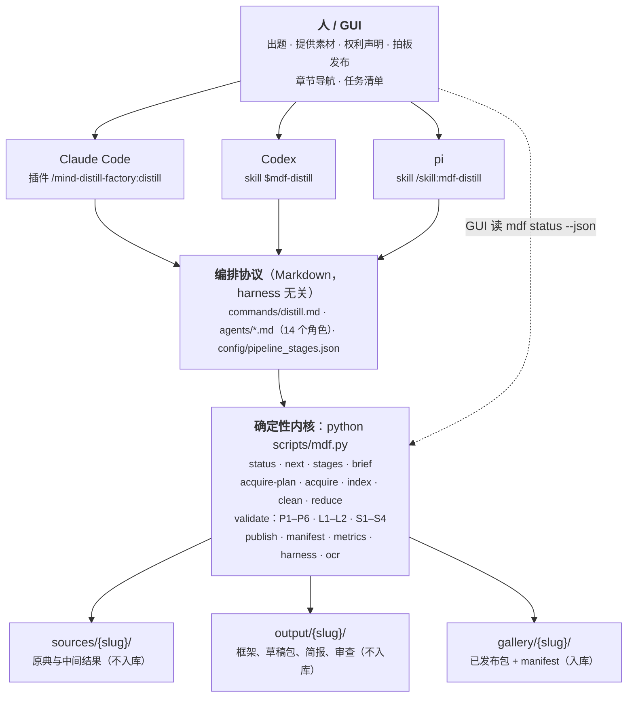
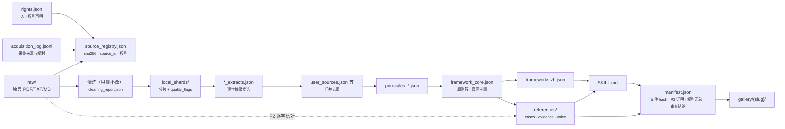
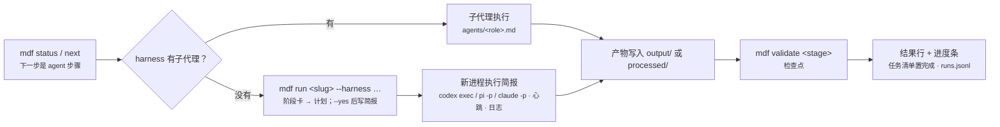
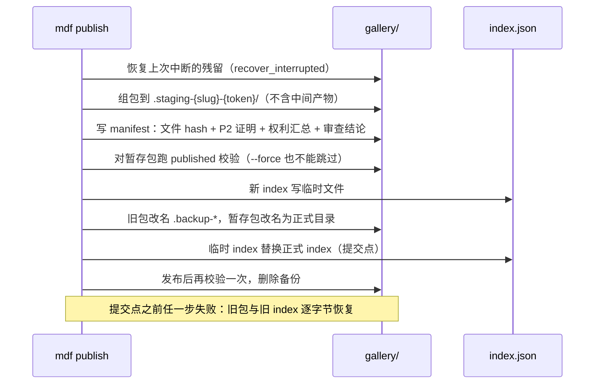
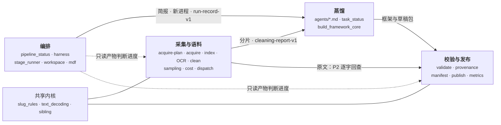

# 架构说明

本文讲**工厂怎样搭起来**：分几层、数据怎么流、闸门放在哪、在不同 harness 里怎么跑。**为什么这样抽取**见 [方法论](methodology.md)；**合规边界**见 [伦理与法律规范](ethics-and-legal.md)。

一句话：**判断交给 agent，事实交给脚本，决定交给人。** agent 负责读和写（抽取、合成、组装、审查）；`mdf` 命令行负责一切能确定判定的事（登记、清洗、分片、闸门、发布）；采不采、能不能用、发不发，由人拍板。

---

## 1. 分层



| 层 | 内容 | 设计约束 |
|----|------|---------|
| harness 适配 | `.claude-plugin/plugin.json`、`.agents/skills/mdf-distill/SKILL.md`、`config/harnesses.json` | 只做**入口与转接**，不复制协议内容，避免三份说明各自漂移 |
| 编排协议 | `commands/distill.md`、`agents/*.md`、`config/pipeline_stages.json` | 纯 Markdown / JSON，任何能读文件、跑命令的 agent 都能执行 |
| 确定性内核 | `scripts/mdf.py` 统一入口，转交给各脚本 | 不调用模型、不联网（`acquire` 与 `acquire-plan` 的目录核对除外，二者走同一套闸门）；人看 Markdown，程序读 `--json` |
| 数据 | `sources/`、`output/`（数据根）、`gallery/`（代码根） | 原典与中间结果在 `.gitignore` 里，放数据根；只有 `gallery/` 的发布内容入库，所以它跟着代码根（当前分支）走 |

---

## 2. 阶段树

阶段、步骤、执行者、检查点都定义在 `config/pipeline_stages.json`，它是唯一来源：`mdf status` 用它排进度，章节标签用它取标题，下面这张图也由它生成（`python scripts/mdf.py stages --mermaid`；测试会比对，配置改了图没跟着改就失败）。

矩形是脚本步骤，圆角是 agent 步骤，平行四边形是需要人参与的步骤，六边形是阶段检查点（不过不放行）。

```mermaid
flowchart TD
    subgraph init["阶段 0 · 意图澄清与初始化"]
        init_init["目录初始化<br/><small>脚本</small>"]
        init_classify[/"类目确认<br/><small>人工、脚本</small>"/]
    end
    subgraph stage1["阶段 1 · 素材采集"]
        stage1_plan(["采集计划<br/><small>agent、脚本、人工</small>"])
        stage1_sources[/"素材入库<br/><small>人工、脚本</small>"/]
        stage1_index["登记、抽取与分片<br/><small>脚本</small>"]
        stage1_clean["清洗与质量闸门<br/><small>脚本</small>"]
        stage1_extract(["分片抽取<br/><small>agent</small>"])
        stage1_reduce["合并与本地补充<br/><small>脚本、agent</small>"]
        stage1_checkpoint{{"✓ validate sources"}}
    end
    subgraph stage2["阶段 2 · 原则提取"]
        stage2_principles(["原则提取<br/><small>agent</small>"])
        stage2_checkpoint{{"✓ validate principles"}}
    end
    subgraph stage3["阶段 3 · 框架合成"]
        stage3_frameworks(["框架合成与自检<br/><small>agent</small>"])
        stage3_checkpoint{{"✓ validate frameworks"}}
    end
    subgraph stage4["阶段 4 · 组装与附件"]
        stage4_assemble(["核心层组装<br/><small>agent</small>"])
        stage4_attachments(["附件生成<br/><small>agent</small>"])
        stage4_gates["P1–P6 包校验<br/><small>脚本</small>"]
        stage4_checkpoint{{"✓ validate package"}}
    end
    subgraph stage5["阶段 5 · 质量审查"]
        stage5_review(["质量审查<br/><small>agent</small>"])
    end
    subgraph stage6["阶段 6 · 发布与安装"]
        stage6_publish["发布<br/><small>脚本</small>"]
        stage6_checkpoint{{"✓ validate published"}}
    end
    init_init --> init_classify
    init_classify --> stage1_plan
    stage1_plan --> stage1_sources
    stage1_sources --> stage1_index
    stage1_index --> stage1_clean
    stage1_clean --> stage1_extract
    stage1_extract --> stage1_reduce
    stage1_reduce --> stage1_checkpoint
    stage1_checkpoint --> stage2_principles
    stage2_principles --> stage2_checkpoint
    stage2_checkpoint --> stage3_frameworks
    stage3_frameworks --> stage3_checkpoint
    stage3_checkpoint --> stage4_assemble
    stage4_assemble --> stage4_attachments
    stage4_attachments --> stage4_gates
    stage4_gates --> stage4_checkpoint
    stage4_checkpoint --> stage5_review
    stage5_review --> stage6_publish
    stage6_publish --> stage6_checkpoint
    classDef agent fill:#eef4ff,stroke:#4a6fd1
    classDef human fill:#fff6e5,stroke:#c98a12
    class init_classify human
    class stage1_plan agent
    class stage1_sources human
    class stage1_extract agent
    class stage2_principles agent
    class stage3_frameworks agent
    class stage4_assemble agent
    class stage4_attachments agent
    class stage5_review agent
```

<!-- BEGIN GENERATED: mdf stages --mermaid -->

<!-- END GENERATED -->

**进度可见性。** 每进入一个阶段，编排者先打一次章节标签：有章节工具的 harness（Claude 桌面版）调用工具，左侧导航就会出现「阶段 N · 标题」；没有的（Codex、pi、终端）输出同名 H2 标题。任何时候 `mdf status <slug>` 都能重建全貌：它只看磁盘上的产物，不依赖对话记忆，所以中断后换个 harness 接着做也不丢进度。

---

## 3. 数据流与证据链



两条不变量贯穿全程：

1. **只删不改。** 清洗只删除整行或整段噪声，从不改写正文，所以证据卡里的逐字原文永远能在 `raw/` 里找回原样（P2）。页码标记作为定位锚点受保护。
2. **同一份解码。** 抽取、清洗、P2 溯源都经过 `scripts/text_decoding.py`（UTF-16 BOM → UTF-8 → GB18030 → Big5），不会出现抽得出、却溯不了源的编码分叉。

---

## 4. 闸门分布

| 位置 | 闸门 | 判定方式 | 失败时 |
|------|------|---------|-------|
| 采集 | 白名单、robots.txt、TDMRep 保留、限速、权利三态、内容类型与大小 | 规则 | 拒绝并记日志，不落盘 |
| 清洗 | PUA / U+FFFD 占比、近重复、页眉页脚 | 规则 + 阈值 | 文件被拒收或打标，写入清洗报告 |
| 阶段 1–3 检查点 | 结构、schema、原则可溯源、过滤链 | 规则 | 不进入下一阶段 |
| 阶段 4（`validate package`） | P1 引文闭合、P2 语料闭合、P3 附件路径、P4 按簇覆盖、P5 案例索引、P6 核心自足；L1 引文长度、L2 在世人物声明 | 规则（无 LLM 打分） | 不进入审查 |
| 阶段 5 | 独立审查，裁决 `[PASS / REVISE / FAIL]` | 隔离的 agent | REVISE 回到对应阶段 |
| 阶段 6（`publish`） | 暂存包重跑 published 校验；审查裁决门 | 规则 | 事务回滚 |
| `--strict` | S1 无 low 证据、S2 审查 PASS、S3 有审查记录、S4 证据来源权利放行 | 规则 | 不得进入正式发布 |

闸门全是规则，没有 LLM 打分：曾有 LLM 审查员把抽查的 7 条引文全判为「EXACT」，而同一组 15 条里有 4 条并非逐字。代理指标（`mdf metrics`：来源集中度、文体距离、人称漂移……）只提示、不拦截，见方法论第六节。

---

## 5. 在不同 harness 里跑

| | Claude Code | Codex | pi |
|---|---|---|---|
| 加载 | 仓库根目录 `claude --plugin-dir .` | 仓库根目录启动，自动扫描 `.agents/skills` | 同 Codex |
| 编排入口 | `/mind-distill-factory:distill <人物>` | `$mdf-distill <人物>` | `/skill:mdf-distill <人物>` |
| 规则来源 | `CLAUDE.md` | `AGENTS.md`（编排 skill 声明以 `CLAUDE.md` 为准） | `AGENTS.md` + `CLAUDE.md` |
| agent 步骤 | 原生子代理（`agents/*.md`），或 `mdf run --harness claude-code` | `mdf run --harness codex`（`codex exec` 新进程） | `mdf run --harness pi`（`pi -p` 新进程） |
| 进度标签 | 桌面版章节工具 `mcp__ccd_session__mark_chapter` | H2 兜底标题 | H2 兜底标题 |
| 任务清单 | `TaskCreate` / `TaskUpdate`（每个 phase 一项） | 自带计划工具 | 无，收尾贴进度条 |
| 叙述 | 阶段卡 `mdf next --card`、结果行 | 同左 | 同左 |

完整说明、核对来源与已知限制见 [harness 适配](harnesses.md)；`python scripts/mdf.py harness` 现场检测本机装了哪些 harness、适配文件是否就位。

agent 步骤在不同 harness 里走不同的路，交付物却一样：



简报自足：角色定义全文、slug、当前状态、规则、检查点都在一个文件里，新进程不需要任何对话历史。这也是 Stage 5「不得自审」在没有子代理的 harness 里也能做到的原因：审查在一个从没见过生成过程的进程里进行。

---

## 6. 发布事务



manifest 不含时间戳，同样的内容重发，manifest 逐字节相同。发布后的校验（`validate published`）只读 `gallery/` 与 manifest：P2 由构建期证明担保，strict 的权利检查读 manifest 里的权利汇总，所以 gallery 可以脱离私有语料独立复核。

装进 harness 的技能目录是写仓库外的操作，工厂不自动做。`python scripts/mdf.py harness plan <slug> --target <harness>` 只打印命令，由用户执行（不复制 `人物档案.md`）。

---

## 7. 目录

```text
mind-distill-factory/
├── .claude-plugin/plugin.json      Claude Code 插件清单
├── .agents/skills/mdf-distill/     Codex / pi 的编排入口
├── commands/distill.md             阶段协议（编排者读）
├── agents/*.md                     14 个角色定义
├── config/
│   ├── pipeline_stages.json        阶段树与章节规则（唯一来源）
│   ├── harnesses.json              各 harness 的入口、子代理、章节能力与核对来源
│   ├── acquisition_policy.json     采集白名单、限速、权利词汇
│   └── taxonomy.json · defaults.json
├── scripts/mdf.py                  统一命令行入口
├── scripts/*.py                    确定性内核
├── templates/                      v6 模板与样例
├── docs/                           架构 · 方法论 · 伦理与法律 · harness 适配
├── sources/{slug}/                 raw/ 原典 · processed/ 中间结果 · rights.json（均不入库）
├── output/{slug}/                  框架、草稿包、简报、审查（不入库）
├── gallery/{slug}/                 已发布包 + manifest.json（入库）
└── tests/                          离线单测（CI：ubuntu + windows × py3.12/3.13）
```

---

## 8. 人在哪里控制

| 节点 | 人做什么 | 工厂怎样配合 |
|------|---------|------------|
| 开题 | 选人物、确认分类、判断在世人物是否适合蒸馏 | `mdf init`；L2 声明闸门 |
| 素材 | 提供原典、写 `rights.json`；批准采集计划（`acquire-plan --approve`）、同意下载 | `mdf acquire` 只放行白名单与已声明权利；`mdf index` 打 WARNING |
| 清洗 | 看被拒、被打标的文件 | `mdf clean` 报告逐文件列出原因 |
| 每个检查点 | 看 `mdf status` | 不过不放行；失败信息带文件与行号 |
| 审查 | 读 `review.md`，接受或要求返工 | 裁决写进 manifest；REVISE、MISSING 需 `--force` 才能发布，并记为 `FORCED_*` |
| 发布与安装 | 决定发不发、装到哪 | 事务式发布；`harness plan` 只打印安装命令 |

---

## 9. 领域模型

代码按领域划分。下面的词在文档、代码、提交信息里含义一致（通用语言）；各上下文只通过带 schema 名的文件交换数据，不互相 import 对方的内部函数（`slug_rules`、`text_decoding`、`sibling` 是共享内核，例外）。

### 通用语言

| 术语 | 含义 | 在代码里 |
|------|------|---------|
| 人物 slug | 一次蒸馏的标识，小写连字符 | `slug_rules.py` |
| 兄弟模块加载 | scripts/ 不是包，脚本与测试按路径取同目录模块；先登记 `sys.modules` 再执行 | `sibling.load_module`、`sibling.load_sibling` |
| 来源 | 一份登记过的原典文件，带权利状态与质量分 | `source-registry-v2` |
| 采集候选 | agent 凭记忆列出的待采作品：篇名写法、语言、要查的目录、why；不含条目号 | `acquisition-candidates-v1`、`acquisition_planner.Candidate` |
| 采集计划 | 目录核对后（✅ 已核对 / ⚠️ 待选定 / ❌ 查不到）用户批准的下载目标，`mdf acquire` 不带参数时读它 | `acquisition-plan-draft-v1` → `acquisition-plan-v1` |
| 采集设置 | 问过用户后存在数据根的联系方式与法域（不入库）；法域未设定时公有领域一律待复核 | `mdf-acquisition-settings-v1`、`acquisition_settings` |
| 可索引素材 | `raw/` 下（含 `mdf acquire` 落下的子目录）`mdf index` 能读的文件；决定「有没有本地素材」 | `source_registry.indexable_raw_files` |
| 分片 | 送给一个 worker 的一段语料，带输入指纹 | `local-source-manifest-v2`、`shard_NNN.json` |
| 清洗结论 | 每个来源通过 / 待复核 / 被拒，以及原因与标记 | `cleaning-report-v1` |
| 可疑行 | OCR 检测到却没认全的行，页码标记写作 `(OCR, k unread)` | `pdf_quality.summarize_lines` |
| 摘录 | worker 从分片里取出的逐字片段，带置信度 | `shard_NNN_extracts.json`、`task-status-v2` |
| 原则 / 框架 | 从摘录归纳的可执行判断；框架是过滤链 | `principles_*.json`、`framework_core.json`、`frameworks.zh.json` |
| 技能包 | v6：`SKILL.md` + `references/` | `validate_output.py package` |
| 证据 | 包里引文在语料中的逐字出处 | P2、`verify_provenance.py` |
| 逐字覆盖率 | 证据卡里有几张被 P2 机器核对过、几张只靠 textual_note 人工放行；闸门通过不等于全核对过 | `verify_provenance.EvidenceCoverage` |
| 闸门 / 检查点 | 能确定判定的通过条件，不过不放行 | P1–P6、L1–L2、S1–S4；阶段树里的 `checkpoint` |
| 闸门通过记录 | 包闸门通过时记下的产物指纹与附注；产物一改就作废 | `gate_records.package_gate_current`、`output/{slug}/.gates/package.json` |
| 预算 | 分片抽取前的规模上限（按 token，配了单价再按费用）与用户批准 | `cost_estimator.Budget`、`mdf budget --approve` |
| 置信度门 | `distill_confidence` < 3 不进 gallery；`--force` 记为 `FORCED_LOW_CONFIDENCE` | `publish_skill.confidence_gate` |
| 阶段 / 步骤 | 流水线的进度单位，执行者是 script / agent / human | `pipeline-stages-v1`、`pipeline-status-v1` |
| 简报 | 把一个执行单位打包成自足的任务说明 | `harness.build_brief` |
| 执行单位 | 一份简报、一个新进程做的事：通常一个步骤；单分片时抽取、合并、原则提取合成 `small-corpus` | `run_unit.RunUnit`、阶段树 `bundles` |
| 运行 | 一次新进程执行：命令、心跳、用量、检查点结果 | `run-record-v1` |
| 工作区 | 代码根（仓库与入库的 `gallery/`）+ 数据根（语料与中间产物），可以分离 | `workspace.Workspace`、`workspace.Workspace.gallery` |
| 产物路径 | 状态文件里存的路径：相对数据根的 posix 形式；旧版存的绝对路径读回时重新挂到当前数据根 | `workspace.Workspace.locate`、`workspace.Workspace.portable` |
| harness 档案 | 一个 harness 怎样起新进程、声明了哪些能力 | `harness.HarnessProfile`、`harness-profiles-v1` |
| 权利声明 | 人写的来源使用许可 | `rights-declaration-v1` |

### 限界上下文



| 上下文 | 拥有的概念 | 模块 | 对外发布 |
|--------|-----------|------|---------|
| 采集与语料 | 采集候选、采集计划、来源、可索引素材、页、分片、清洗结论、可疑行 | `acquisition_planner`、`acquisition_settings`、`acquire`、`local_source_pipeline`、`pdf_quality`、`ocr_calibrate`、`clean_corpus`、`sampling`、`cost_estimator`、`worker_dispatch`、`source_registry` | `source-registry-v2`、`local-source-manifest-v2`、`cleaning-report-v1`、`sampling-plan-v1`、`cost-estimate-v1`、`worker-dispatch-plan-v1`、`acquisition-log-v1`、`acquisition-candidates-v1`、`acquisition-plan-v1` |
| 蒸馏 | 摘录、原则、框架、草稿包 | `agents/*.md`、`task_status`、`build_framework_core` | `task-status-v2`、`framework_core.json` |
| 校验与发布 | 闸门、证据、逐字覆盖率、闸门通过记录、置信度门、发布包、清单 | `validate_output`、`verify_provenance`、`gate_records`、`package_manifest`、`publish_skill`、`measure_package`、`persona_metrics` | manifest（`manifest_version` 2）、`persona-metrics-v1`、`claim-ledger-v1` |
| 编排 | 阶段与步骤、执行单位、简报、运行、工作区、harness 档案 | `pipeline_status`、`run_unit`、`harness`、`stage_runner`、`workspace`、`mdf` | `pipeline-status-v1`、`run-record-v1`、`mdf-harness-v1`、`mdf-doctor-v1` |

### 不变式（由测试守住）

- **可索引素材**：「`raw/` 里有哪些素材」只由 `indexable_raw_files` 判定（递归，格式与索引器一致），检查点 1 与状态表都用它；采集落在子目录里的语料同样要求先 `mdf index`。
- **证据链**：清洗只删不改；index、清洗、P2 共用同一个解码器。所以包里的引文总能在语料里逐字回查。
- **OCR 来源**：只要有一页靠 OCR，来源就带 `ocr_text`，该页引文不高于 medium；有可疑行的页标出漏了几行。
- **工作区**：数据根的解析规则（`--root` > `MDF_DATA_ROOT` > 仓库根）只在 `workspace.py` 定义一次，有架构测试禁止别处再写。分离时，新进程被授权访问数据根，简报写明路径约定；检查点命令只有一种改写，`mdf run` 和简报都用它。
- **数据根可整体挪动**：产物里不依赖绝对路径。`task_status`（`input_path`、`expected_output`、`manifest_path`、`output_paths`）和 manifest 的目录字段只存相对数据根的路径，读取一律经 `Workspace.locate`；旧版存的绝对路径只取 `sources/…` 或 `output/…` 起的部分重新挂到当前数据根，不信任写入时的位置。状态文件的数据根由它自己所在的目录认出（`Workspace.containing`），不看环境变量，所以复制到别处的副本只认副本里的产物，挪走后进度也跟着走。`tests/test_portable_data_root.py` 扫描 index 之后 `processed/` 下的每个 JSON，出现数据根的绝对路径即失败。
- **harness 档案**：`isolated_run` 必须有独立的 `{prompt}` 参数位。没声明的能力，指定了就报错（模型、推理强度），或者跳过（目录授权）；可变参数放在提示词之后。
- **运行**：不加 `--yes` 什么也不写。每次运行都追加一条 `run-record-v1`，含费用和被拒的工具调用数。新进程不得再派子代理：简报写明禁令，派了就记进 `warnings` 并告警（`stage_runner.run_warnings`），不判失败。
- **执行单位**：「这次做哪几步、扮演哪些角色、跑哪些检查点」只由 `run_unit.plan` 判定，简报、`mdf run` 与阶段卡共用。合并单位只在分片数 ≤ `max_shards`、所请求的步骤本身未完成、且剩下至少两步时成立；成员的检查点一律都跑，单个步骤的阶段检查点仍等本阶段做完再跑。
- **发布**：事务式改名，manifest 记下构建期的证明。改了 gallery 却没重发 manifest，测试就失败。`output/`、`sources/` 从数据根读，`gallery/` 与 `gallery/index.json` 只写代码根（`Workspace.gallery`）；`validate published`、`mdf status` 与 `mdf run` 也在代码根下找 gallery。库函数的 `gallery_root` 缺省为 `root/gallery`（两根同处时行为不变），由入口显式传入，所以测试夹具不会碰到仓库里的 gallery。数据根在仓库外时数据根下不出现 `gallery/`（`tests/test_publish_data_root.py`）。
- **按路径加载**：scripts/ 与 evaluation/scripts/ 里只有 `sibling.py` 直接调用 `spec_from_file_location`，它先把模块登记进 `sys.modules` 再执行，失败则撤销。`from __future__ import annotations` 下的 dataclass 要到 `sys.modules[cls.__module__]` 查注解，没登记就崩——`Budget`、`Workspace`、`EvidenceCoverage` 各踩过一次。要用兄弟模块就调 `sibling.load_sibling`，别再自己写加载函数；有架构测试守着。
- **逐字覆盖率**：覆盖率的文字格式、解析和 manifest 字段只在 `EvidenceCoverage` 定义；它随闸门通过记录和 manifest 一路传到状态表的包校验行与发布行。语料位置不在 `raw/`、只靠 textual_note 放行的证据卡不高于 medium（规则 6）。
- **闸门通过记录**：绑定 SKILL.md 与 references/ 的指纹，产物改过即作废，附注随之作废；不随发布进入 gallery。
- **置信度门**：`distill_confidence` < 3 的包发布被拒；`--force` 放行时审查状态记 `FORCED_LOW_CONFIDENCE`，绝不记 PASS。
