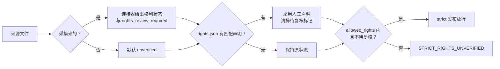

# 伦理与法律规范

> **不构成法律意见。** 本文说明本工厂在工程上**怎样**降低版权、人格权与伦理风险，以及每条规则对应的法律或伦理依据。不同法域的规则不同，是否构成合理使用、引用要看个案。准备公开发布、商用，或者涉及在世人物、有争议的人物时，请咨询所在法域的专业律师。文中法条都是概述，以官方正式文本为准。

配套文档：[方法论](methodology.md)（证据链与抽取方法）· [架构](architecture.md)（流水线与闸门的位置）。

---

## 1. 立场：做的是研究性重建，不是复制，也不是冒充

工厂的产物是一份**思维框架**：综合判断（原则、闸门、盲区）加上**引用量级**的逐字摘录（证据卡、语感样本），每一句摘录都能追到原典。由此得出三条底线：

| 底线 | 含义 | 工程落点 |
|------|------|---------|
| 原文不随包走 | 原典全文只在本地 `sources/{slug}/raw/` 做计算分析，发布的包里只有摘录 | `sources/*` 已写入 `.gitignore`；`人物档案.md` 不进安装目录 |
| 摘录是引用量级 | 每条引文有长度上限，全包摘录有总量上限 | L1：`QUOTE_TOO_LONG_*`、`EVIDENCE_TOTAL_TOO_LONG` |
| 模拟不是冒充 | 第一人称是「依据公开著述的推理重建」，不是本人发言 | L2：在世人物声明；边界规则；误归属陷阱清单 |

权利判断、在世人物是否适合蒸馏、是否发布，都是**人的决定**。脚本只做两件事：把决定需要的事实摆出来，在缺少决定时 fail-closed（拦下，不放行）。

## 2. 采集：合法获取是一切的前提

`mdf acquire` 的每道闸门都对应一条外部规则（实现见 `scripts/acquire.py`，策略见 `config/acquisition_policy.json`）：

| 闸门 | 规则 | 依据 |
|------|------|------|
| 主机白名单 + 仅 https | 只访问策略里列出的站点；重定向到白名单外 → 拒绝 | 最小权限；防止被重定向到未审查的来源 |
| User-Agent 带联系方式 | 没配 `contact`（策略、环境变量 `MDF_CONTACT` 或 `mdf acquire-settings` 存的本地设置）就不发请求 | Wikimedia User-Agent 政策要求可识别、可联系；Internet Archive 同理 |
| robots.txt | 按 RFC 9309：最长匹配优先；4xx（429 除外）视为全部允许；5xx、429 或连不上视为全部禁止 | RFC 9309；也是 EU DSM 第 4 条「机器可读方式保留权利」最常见的表达 |
| TDMRep 保留 | 先读站点 `/.well-known/tdmrep.json`（按路径首个匹配），再看响应头与 HTML meta（后者覆盖前者）；`tdm-reservation=1` 即拒绝，并在拒绝原因里给出权利人的 `tdm-policy`。站点级已保留时正文一个字节都不取 | W3C TDMRep（2024 终版报告）；EU DSM 第 4 条的机器可读保留 |
| 限速与预算 | 每主机最小间隔、单次请求上限；429/5xx 按 `Retry-After` 退避，有封顶 | 不给对方站点造成负担 |
| Project Gutenberg | 只走配置好的镜像，不爬主站 | Gutenberg 的 robot 政策禁止自动访问主站，要求用镜像 |
| Internet Archive | 标为 access-restricted 的条目一律拒绝（借阅类不是公开资源） | 受限借阅 ≠ 合法开放获取 |
| 权利状态 | 每个目标先判 allow / review / refuse，见下一节 | 见第 3 节 |

`contact` 是维护者自己选择公开的联系方式（可以是项目主页 URL），请放在环境变量里，或问过用户后用 `python scripts/mdf.py acquire-settings --contact <URL>` 存进数据根的 `.mdf/acquisition.json`（`.gitignore` 忽略，不入库），**不要把个人邮箱提交进仓库**。优先级：策略文件 > `MDF_CONTACT` > 本地设置。采集日志 `processed/acquisition_log.jsonl` 只记目标、URL、hash 与权利判断，不记个人信息。

### 采集计划：先核对目录，再下载

「该采哪些书」由 acquisition-scout 凭记忆列候选（不联网），`mdf acquire-plan` 核对目录，用户批准后才写进 `acquire` 读的计划文件（流程见 `commands/distill.md` 1.0 节）。目录核对也是网络访问，走与下载相同的闸门（白名单、https、User-Agent、robots.txt、TDMRep、限速与请求上限），并且**只用各站点允许自动访问的目录入口**：

| 站点 | 用什么核对 | 不用什么、为什么 |
|------|-----------|-----------------|
| 维基文库 | 作者页 `/wiki/作者:<名>`、作品页 `/wiki/<篇名>`（robots.txt 放行） | 搜索接口 `/w/api.php`、`/wiki/Special:Search` 对爬虫是 Disallow；本地化的搜索页别名（如 `特殊:搜索`）虽然没被字面列出，用它绕开同样违背站点意图，不用 |
| Internet Archive | `advancedsearch.php`（robots.txt 放行），排除 `inlibrary` / `printdisabled` / `lendinglibrary` 借阅馆藏 | 借阅类条目不是公开资源 |
| Project Gutenberg | 离线目录 `pg_catalog.csv`（用户自行下载后 `--gutenberg-catalog` 指定） | 网站禁止自动访问，目录也不在线查 |

目录里查不到的条目不进计划；同名但作者对不上、或落在消歧义页的只标「待选定」，不能批准。计划阶段的权利判断只是预判，下载时 `acquire` 按取回的页面重新判定。

## 3. 权利状态：词汇表与判定

所有来源（采集的或本地自备的）在 `sources/{slug}/processed/source_registry.json` 里都有一个 `rights_status`：

| 状态 | 含义 | 默认判定 |
|------|------|---------|
| `public_domain` | 已进入公有领域（作者卒年、出版年已过保护期） | allow |
| `cc0` / `cc-by` / `cc-by-sa` | 对应知识共享许可（署名类须保留署名） | allow |
| `user_owned_copy` | 使用者合法持有的副本，只在本地做计算分析，原文不分发 | allow |
| `permission_granted` | 已取得权利人许可 | allow |
| `public_domain_us` | 仅在美国是公有领域（例如 1929 年前在美出版） | 只有 `jurisdiction` 为 `US` 时 allow，否则 review |
| `unknown` | 尚未查清 | review |
| `unverified` | 本地文件的默认值：没人声明过 | refuse（strict 下） |
| `restricted` | 明确受限 | refuse |



### 人工权利声明 `sources/{slug}/rights.json`

本地自备的书没有任何机器可读的权利信息，只有人能回答「这本书我能不能这样用」。写一份声明，再重跑 `mdf index`：

```json
{
  "schema": "rights-declaration-v1",
  "declarations": [
    {"path": "张太岳集*.txt", "rights_status": "public_domain", "basis": "张居正卒于 1582 年；底本为明刻本影印"},
    {"path": "传记/*", "rights_status": "user_owned_copy", "basis": "自购纸书扫描，仅本地分析，包内只含引用量级摘录"}
  ]
}
```

- `path` 是相对 `raw/` 的 POSIX glob，按顺序**首个匹配**生效；
- `basis`（权利依据）必填，会写进登记表，供审查和日后追责；
- 状态不在词汇表里、缺 `basis` 的条目跳过，`mdf index` 打 WARNING，不阻断；
- 声明本身就是那次人工复核，所以会清掉采集阶段留下的 `rights_review_required`。

注意 `user_owned_copy` 的边界：持有一本书**不等于**可以分发它的内容。它之所以能放行，是因为本工厂只在本地做计算分析，对外只发布引用量级的摘录，而这一点由 L1 闸门兜底。

## 4. 发布闸门

| 代码 | 规则 | 何时生效 | 实现 |
|------|------|---------|------|
| `QUOTE_TOO_LONG_CORE` | `SKILL.md` 每条结构化引文（题记、原文出处、标志性名言）≤ 240 字 | 默认 | `check_quote_lengths` |
| `QUOTE_TOO_LONG_EVIDENCE` | 每张证据卡的逐字原文 ≤ 400 字 | 默认 | 同上 |
| `QUOTE_TOO_LONG_VOICE` | 每个语感样本的原文 ≤ 200 字 | 默认 | 同上 |
| `EVIDENCE_TOTAL_TOO_LONG` | 全包证据原文合计 ≤ 15000 字 | 默认 | 同上 |
| `LIVING_PERSON_NOTICE_MISSING` / `_INCOMPLETE` | 在世人物必须有声明行，且写明依据「公开」著述、「不代表」本人 | 默认 | `check_living_person_notice` |
| `STRICT_NO_RIGHTS_RECORD` | 没有来源登记表（或旧 manifest 里没有权利汇总） | `--strict` | `check_strict_rights` |
| `STRICT_RIGHTS_UNVERIFIED` | 有证据卡来自权利未放行或待复核的文件 | `--strict` | 同上 |

字数按**非空白字符**计。上限是照着实测数据定的：样板包 `zhang-juzheng-v6` 核心层引文最长 58 字、证据卡最长 291 字（中位 80.5）、语感样本最长 50 字、证据原文合计 3186 字；旧版包核心层引文最长 216 字。上限比实测高出一截，正常蒸馏碰不到；碰到了就说明摘录已经从「引用」滑向「复制」。

权利汇总在**构建期**写进 manifest 的 P2 证明（`attestation.p2.rights`）：按证据卡逐字定位到语料文件，再查登记表。发布后的 `published --strict` 只读 manifest，不需要原始语料。

### 这些数字不是法律上的安全港

没有任何法域规定「400 字以内就是合理引用」。长度上限是一个**工程代理指标**：它保证摘录在量上远离「替代原作」，但合理使用、适当引用还要看目的、性质、对原作市场的影响。

## 5. 依据

### 版权：引用与计算分析

- **中国《著作权法》（2020 年修正）第 24 条**：列举可以不经许可、不付报酬使用作品的情形。第（二）项是为介绍、评论某一作品或说明某一问题，在作品中**适当引用**他人已发表的作品，前提是指明作者姓名、作品名称，并且不得影响作品的正常使用，也不得不合理地损害权利人的合法权益。对应工程：每张证据卡必须有「出处」字段（P2 + 证据卡规则），引文有长度上限（L1）。
- **新加坡《Copyright Act 2021》s191**：合理使用（fair use），列了四个非穷尽因素，其中包括使用的目的与性质、所用部分占整体的数量与实质性、对原作潜在市场的影响。L1 直接回应「数量与实质性」这一项。
- **新加坡《Copyright Act 2021》ss243–244**：计算数据分析例外。s244(2) 列了五项条件，其中一项是对原材料**合法访问**；绕过付费墙、违反使用条款不算合法访问。对应工程：`index` / `clean` 是本地计算分析；采集侧拒绝 access-restricted 条目，不绕过任何访问控制。这一例外只覆盖分析本身，**不覆盖**把摘录发布出去，后者仍要按 s191 或引用规则判断。
- **欧盟 DSM 指令（2019/790）第 3 条**：科研机构、文化遗产机构为科学研究做文本与数据挖掘，权利人不能选择退出。**第 4 条**：其他主体的文本与数据挖掘例外，但权利人可以保留权利；对网上公开的内容，可以用机器可读方式（例如 robots.txt、W3C TDMRep）表达保留。对应工程：robots.txt 与 W3C TDMRep 都遵守，`tdm-reservation=1` 一律拒绝采集（`config/acquisition_policy.json` 的 `respect_tdm_reservation`，只有符合第 3 条的科研机构、文化遗产机构才可以改为 false）。

### 人格权：姓名、名誉，包括已故者

- **《民法典》第 1014 条**：任何组织或个人不得以干涉、盗用、假冒等方式侵害他人的姓名权。第一人称模拟如果被当成本人发言，就落在「假冒」的风险区；所以在世人物必须声明「不代表本人」（L2），任何人物的包都不得用于冒充。
- **《民法典》第 1024 条**：民事主体享有名誉权，不得以侮辱、诽谤等方式侵害。对应工程：每条原则必须有逐字出处（P1/P2），不允许编造言论；「已知盲区」要求写成有依据的批评，并附缓解建议，而不是贬损。
- **《民法典》第 994 条**：已故者的姓名、肖像、名誉、荣誉、隐私、遗体等受到侵害的，其配偶、子女、父母（没有这些人时由其他近亲属）可以依法请求侵权人承担民事责任。**已故不等于可以随意演绎。** 近现代人物（近亲属可能在世）尤其要守住溯源与边界规则。
- **《民法典》第 185 条与《英雄烈士保护法》**：侵害英雄烈士姓名、肖像、名誉、荣誉、损害社会公共利益的，另有专门规制。涉及这类人物，蒸馏结果必须经人工审查后才能公开。

## 6. 伦理：第一人称模拟的风险与对策

| 风险 | 对策 | 落点 |
|------|------|------|
| 编造言论，「听起来像他说的」 | 引文必须逐字出现在原典；网络转载的引文最高 medium | P1/P2，Rule 6，误归属陷阱清单 |
| 把演绎当史实（小说、影视、伪托名言） | 每个人物写专属边界规则，点名已知误归属来源 | 边界规则第 6 条（按人物定制） |
| 对身后事件妄下断语 | 生前事件第一人称；身后事件改为方法论推演，并标注时间边界 | 边界规则 1–2 |
| 替在世人物表态 | 拒绝评价在世人物；包本身是在世人物时必须声明 | 边界规则 3；L2 |
| 把结构性困境归咎于个人 | 先充分承认结构性因素，再谈局部可行动的空间 | 价值导向；边界规则 5 |
| 神化人物 | 必须写已知盲区，每条附缓解建议 | Rule 2；P6 |
| 用户把模拟当权威 | 涉及数据、法律、医疗的内容标注须另行核实 | 边界规则 4 |

## 7. 撤回与更正

权利人、人物近亲属或任何读者提出有依据的异议时：

1. 在 `sources/{slug}/rights.json` 把相关文件改为 `restricted`（或直接从 `raw/` 移除），重跑 `mdf index`；
2. 重新组装、过闸门；被移除来源上的证据卡会让 P2 失败，迫使对应原则改写或删除；
3. 重新发布（`mdf publish`，事务式替换）；必要时从 `gallery/` 与安装目录下架；
4. 在审查记录里写明异议内容、处理结论与日期。

## 8. 已知限制

- **不判断真假**：`rights_status` 是人的声明，脚本核实不了它是否属实；`basis` 必填，正是为了让声明可以追溯、可以问责。
- **法域**：权利词汇按「公有领域 / 许可 / 自有副本」粗分；保护期在各国不同（例如作者卒后 50 年还是 70 年），由声明人自行判断。
- **TDMRep 的保守取舍**：站点级声明保留时直接拒绝，不再发请求去探测响应头或 meta 是否把它覆盖回 0（宁可少采）。用 `--local` 导入的 PDF、EPUB 里内嵌的 TDM 元数据（XMP `tdm:reservation`）没有解析；本地文件的权利由人在 `rights.json` 里声明。
- **长度不等于合理**：L1 只管量，管不了目的、性质和市场替代，后者靠 Stage 5 人工审查。
- **在世判定靠生卒年行**：只认身份卡下的 `**姓名** · 生年–卒年` 一行；格式不同的包不会被识别为在世人物，组装规范要求统一这一行。
