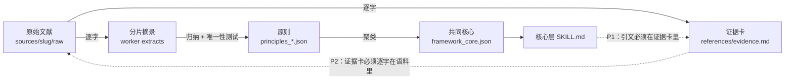

# 方法论：从文献到可执行的思维框架

本文说明工厂**怎样**把一位思想家的文字变成一个 Skill 包，以及每一步**凭什么**可信。工程实现（命令、目录、闸门代码）见 [architecture.md](architecture.md)；法律与伦理约束见 [ethics-and-legal.md](ethics-and-legal.md)。

> 一句话：我们提取的是**可执行的推理算法**（遇到什么局面、先问什么、在哪里止步）、**表达质感**（他怎么说话）和**价值取向**（他追求什么、拒绝什么、在哪里自相矛盾），每一条都要能追回到具体文献。它不是模仿秀，也不是人物百科。

---

## 一、证据链：每句话都要能追回去

- **P1（引文闭合）**：`SKILL.md` 里出现的每一句引文，都必须逐字出现在某张证据卡里。
- **P2（语料闭合）**：每张证据卡的原文，都必须逐字出现在本地语料（raw 文本或与 PDF 哈希绑定的抽取侧车）里。比对前只去标点空白、做繁简折叠，不做任何模糊匹配。
- **主张账本**（`python scripts/mdf.py metrics <slug> --write` → `output/<slug>/claim_ledger.json`）把每条原则、引文、语感样本绑定到 `证据卡 → 语料文件 → source_id / sha256 / 权利状态`。决策闸门与盲区属于**综合判断**，账本把它们单列为 `basis: synthesis`，不假装它们能逐字溯源——审查者据此知道哪些主张要靠论证、而不是靠引文来支撑。

### 证据等级（CLAUDE.md 规则 6）

| 来源 | 最高 confidence | 说明 |
|---|---|---|
| 用户提供的一手文献（原典、文集、书信、讲话逐字稿） | high | 必须写明「语料位置」，并通过 P2 |
| 已出版的权威整理本 | high | 同上 |
| 网络检索得到的引文 | medium | 无法逐字对照原件 |
| 二手分析、传记 | —— | 用于盲区、争议与背景，不作为本人原话 |
| 现代注释、译文、评析 | —— | **不得记在本人名下**（见下） |

**两类已发生过的误归属陷阱**：

1. **注释者的话被当成本人的话**——《帝鉴图说》唐暨礼注评本里，现代注评（含「选举权」「纳税人」等概念）曾被当作张居正原话抽出。现在清洗闸门会检测「【注释】」「【译文】」「译者注」等标记，给来源打上 `modern_annotation`，抽取 agent 必须区分原文与注释。
2. **文艺作品被当成史实**——熊召政小说与电视剧之于张居正、音乐剧之于汉密尔顿、电影《角斗士》之于马可·奥勒留。这类陷阱写进每个包的专属边界规则，由质量审查专门核查。

---

## 二、语料：获取、清洗与抽样

### 获取（`mdf acquire`）

只从白名单来源取公有领域或自由许可文本，每一道闸门 fail-closed，结果写进 `acquisition_log.jsonl`，`source_registry.json` 据此记录每个文件的来源 URL 与权利状态。细节见 ethics-and-legal.md。

### 清洗（`mdf index` 内置，`mdf clean` 查看）

核心原则是**只删不改**：P2 拿引文去 raw 里逐字比对，所以清洗只能整行、整段、整页地删除噪声，绝不改写保留下来的字符（不做繁简转换、不改标点、不拼接断词）。

| 删除对象 | 判定方式 |
|---|---|
| 古登堡版权页 | `*** START/END OF THE PROJECT GUTENBERG EBOOK` 之外的部分 |
| Google 扫描书使用须知 | 卷首 6000 字内命中 ≥2 条须知特征句 |
| 电子书网站广告 | 同时含强线索词（电子书、公众号、二维码、粉丝群、网址……）与广告动词，且 ≤80 字 |
| 页码 | 单独成行的页码，全文 ≥3 处才删（零星数字可能是章节号） |
| 页眉页脚 | 文本文件：重复 ≥8 次且占非空行 ≥2%、**60% 以上紧挨分页处**；PDF：出现在 ≥30% 有字页的首尾两行 |
| 书后索引、目录 | 连续 ≥12 行「词条, 页码」或「标题……页码」 |

**刻意不删的**（真实语料校准时都曾被误删）：带数字的标题（「FEDERALIST 2」是篇目）、说话人标签（「问：」「Q」）、重复出现但不在分页处的行（书信集里的「To Edwin M. Stanton」是收信人抬头）、显式页码标记（`===== PDF_PAGE n =====`、`--- Page n ---`、`≦ n ≧` 是引用定位依据）、研究笔记里的 URL。

每个来源得到一个结论：

| 结论 | 含义 | 典型原因 |
|---|---|---|
| accepted | 进入分片 | —— |
| flagged | 进入分片，需人工复核；passage 带 `quality_flags` | 现代注释、用过 OCR（`ocr_text`）、OCR 置信度 <0.9、少量私用区字形、删除量 >10% |
| rejected | 不进入分片 | 乱码（UTF-8 被当 GBK/Latin-1 保存过）、U+FFFD >0.5%、私用区字形 >5%、清洗后为空、扫描件且 OCR 不可用、OCR 乱码（过半页靠 OCR 且置信度 <0.6） |
| duplicate | 只抽一份 | 字节相同；或去空白标点后 8-gram 指纹 Jaccard ≥0.85；或被另一来源 ≥90% 包含且优先级不更高 |

**校准记录**：规则在主仓库 253 个真实 raw 文本上只读校准，结果 238 通过 / 12 待复核 / 3 被拒（2 个空文件、1 个 74% 是 U+FFFD 的损坏文件）。

**OCR 校准**（`mdf ocr calibrate`）：把一份已知真值的文本（`evaluation/fixtures/ocr/sample_zh.txt`：繁体文言、简体白话、数字与中英混排）渲染成没有文字层的扫描件，分四档退化（无 / 轻：倾斜、模糊、噪点 / 重：再加降采样 / 严重：低分辨率翻拍），噪点带固定种子，重跑结果一致。图送进 index 用的同一条 PDF→OCR 路径，与真值比两个数：字符错误率 CER，以及**逐字存活率**，即真值里每句话（≥6 字）按 P2 的归一化规则能否在 OCR 文本里原样找回。证据链看的是后者：CER 只有 2%，也可能让一成以上的引文过不了 P2。`--backend all` 让每个装好的引擎读同一批图。真实扫描件没有真值，用 `mdf ocr scan <pdf>` 逐页看分类、OCR 状态与置信度。

2026-10-18 本机实测（宋体 200 dpi，3 页 19 句，`mdf ocr calibrate --backend all`；格内为逐字存活率 · 平均置信度 · CER）：

| 引擎 | 无 | 轻 | 重 | 严重 |
|---|---|---|---|---|
| `rapidocr` 3.10（PP-OCRv6 small，ONNX） | 95% · 0.995 · 0.4% | 89% · 0.982 · 0.6% | 79% · 0.977 · 2.3% | 32% · 0.918 · 6.7% |
| `paddleocr_json`（Umi-OCR 2.1.5 自带，PP-OCRv3 简中） | 47% · 0.916 · 4.6% | 53% · 0.909 · 4.8% | 26% · 0.874 · 12.8% | 0% · 0.575 · 49.0% |

从这张表得出三条，都已落进代码：

1. **默认引擎是 rapidocr**。差距来自模型代际而不是框架：rapidocr 跑的就是 PaddleOCR 的模型（转成 ONNX），3.x 自带 PP-OCRv6；Umi-OCR 2.1.5 的插件带的是 PP-OCRv3，繁体页几乎整页丢失。换成 Umi 的繁中模型配置，简体页又大幅变差（逐字存活 5–21%），因为一份文档只能用一套模型；`limit_side_len=2880` 也没有改善。想用 PaddleOCR-json 时，把 `MDF_PADDLEOCR_JSON` 指向它的 exe 或所在目录，额外启动参数放在 `MDF_PADDLEOCR_JSON_ARGS`，再用 `MDF_OCR_BACKEND=paddleocr_json` 把 index 钉在它上面。
2. **置信度只是弱代理**。置信度 0.918 的那一档只有 32% 的句子逐字存活；0.9 以上的各次运行，逐字存活率从 32% 到 95% 都有。所以阈值只拦明显坏的：平均置信度低于 0.9 标 `low_ocr_confidence`，实测这一档逐字存活率都不超过 26%。低于 0.6、且过半页靠 OCR 的，判 `ocr_garbled` 整份退回，实测 CER 都在 49% 以上，逐字存活为 0。
3. **真正的防线是 `ocr_text`**。来源里只要有一页是 OCR 出来的，就带这个标记，该页的页码标记写作 `--- Page n (OCR) ---`。P2 拿引文去比的正是这份 OCR 文字，认错的字它查不出来。最好的引擎在无退化样张上也有 1/19 句不能逐字还原（「鮮矣」被重复识别了一次）。所以 OCR 页上的引文默认不高于 medium，对照原图核实过才能标 high。

**解码一致性**：抽取（index）与溯源（P2）共用 `scripts/text_decoding.py`：UTF-16（带 BOM）→ UTF-8 → GB18030 → Big5 → UTF-8 替换模式。过去两边不一致，GBK 编码的中文电子书能被抽取、引文却永远过不了 P2。

### 抽样

大语料先分层（来源优先级 × 语言 × 抽取质量带 × 来源文件）再按带种子的 SHA-256 稳定排序抽取：每层取 45%（向上取整）、至少 1 个单元，并输出覆盖报告（`sampling_plan.json`）。抽样是确定性的：同一语料、同一种子，抽到的分片完全相同，可复现、可审计。

---

## 三、思想：从摘录到原则

### 唯一性三层测试（principle-extractor）

1. **去名测试**：把人名去掉，这条原则还是这个人独有的吗？「要努力工作」不是任何人的原则。
2. **输入证据锚点**：至少 2 条本地素材支撑才算 `uniqueness_source: input_evidence`；只凭模型记忆的标 `model_memory`，唯一性封顶 3 分。度量工具另给一个确定性代理：原则表述与其证据卡原文是否共享内容片段（`anchor_terms`），一个都没有就报 `PRINCIPLE_NO_ANCHOR_OVERLAP`。
3. **方法论层级检查**：它是一条可执行的推理方法，还是一句结论或口号？

### 决策框架必须是过滤链

3–8 步，每一步是以「？」结尾的是/否闸门，不允许开放式的最后一步。理由：开放式问题把判断推回给模型的默认分析腔，过滤链才把这位思想家的**先后次序**和**止步条件**固定下来。

### 每条原则必须写清

- **失效边界**：这条原则在什么条件下不适用，硬套会导致什么；
- **情报前提**：应用之前必须先查明什么。

---

## 四、人格：价值、张力与盲区

- **价值取向与反模式**：至少 2 条坚定追求、2 条坚决反对、1 条**未解决的内在张力**。张力防止人物被压扁成一维的「正确答案机」。
- **已知盲区**：至少 2 条，每条必须带**缓解建议**。没有哪位思想家是无误的，盲区告诉使用者何时该换一个视角。
- **建设性价值导向**：用户谈不公与困境时，先**完整承认**结构性困难是真实的，再转向局部可行的策略（降低风险、积累技能、换战场、互助网络），最后才是该人物特有的韧性。不把结构问题偷换成「再努力一点」。

---

## 五、表达：表达 DNA 与语感样本

**表达 DNA 八维**：句式、修辞、语气、确定性、幽默、禁忌，以及两个输出层维度——**段落节奏**与**对话标记**。每维都要具体到能与通用分析腔区分，并配 ✅/❌ 校准示例。

**语感样本库**（`references/voice.md`）：≥20 条，每条包括原文、「为什么像他/她」、以及「误写成通用分析腔会变成」的反例。反例不是装饰：度量工具用全部反例作为**通用腔基线**，比较核心层第一人称阐释的文体指纹更接近本人语料还是更接近基线。

**结构自然性五条**：句长变化 >30%、段落长短不一（1–6 句）、打破对称罗列、段落开头多样、允许不完美的过渡。
**反套公式六条**：不顺序罗列、深度匹配问题复杂度、用表达 DNA、不给原则编号、注意事项简短、不重复结尾口号。

---

## 六、确定性代理指标（`mdf metrics`）

这些数字回答「能不能追回去」「是不是一本书说了算」「像不像本人」「对话有没有走样」。它们是**代理指标，不是放行闸门**——放行仍由 P1–P6 与隔离审查决定。阈值集中在 `scripts/persona_metrics.py` 的 `LIMITS` 与 `scripts/clean_corpus.py` 的 `THRESHOLDS`，改动须同步本文。

### 包层

| 指标 | 定义 | 关注阈值 |
|---|---|---|
| 原则可溯源 | 有 ≥1 张能逐字追到语料的证据卡的原则 / 全部原则 | 任一原则不可溯源 → `PRINCIPLE_UNTRACED` |
| 引文闭环 | 引文 → 在证据卡里 → 证据卡在语料里 | 三个数字应相等 |
| 语感样本逐字率 | 能逐字追到语料的语感样本占比 | 仅报告 |
| 单一来源集中度 | 已溯源证据卡里最大来源占比、HHI | >60%（≥3 张卡时）→ `SINGLE_SOURCE_CONCENTRATION`；主语料是全集时属正常，核对关键原则是否另有独立来源 |
| 证据锚点 | 原则表述与证据原文共享的 CJK 双字组 / 英文词 | 为空 → `PRINCIPLE_NO_ANCHOR_OVERLAP` |
| 文体指纹 | 句长均值与变化系数、问句/感叹句比例、第一人称密度、文言虚词密度、现代连接词密度、每句逗号数 | 核心层更接近通用腔基线 → `CORE_PROSE_GENERIC_STYLE` |
| 来源登记 | 证据所在文件是否在 `source_registry.json` | 未登记 → `SOURCE_NOT_REGISTERED` |

实测（张居正 v6 发布包）：原则 9/9 可溯源，引文 19→19→19 闭环，证据卡 34/34 已溯源，核心层文体距本人语料 0.437、距通用腔 0.498（更像本人）；82% 的证据来自《张居正全集》——全集为主语料，属预期。

### 对话层（`--dialogue`）

接受 `.jsonl` / `.json` 或 `evaluation/reports/*/runtime-dialogue-test.md` 的「**Q:** … **A:** …」格式。

| 关注项 | 判定 |
|---|---|
| `THIRD_PERSON_DRIFT` | 回答里出现「本人姓名 + 认为/说/主张……」 |
| `ORDINAL_ENUMERATION` | >20% 的回答含「第一…第二」「首先…其次」「一是…二是」或 ≥3 行列表 |
| `CLOSING_REPETITION` | 同一结尾句出现 >1 次 |
| `UNIFORM_SENTENCE_LENGTH` | ≥5 句的回答句长变化系数 <0.30 |
| `UNIFORM_PARAGRAPHS` | ≥4 段且每段句数相同 |
| `LENGTH_MISMATCH` | 问题 <30 字而回答 >1200 字 |
| `SECOND_PERSON_LECTURING` | ≥25% 的回答含「你应该/你必须/你需要」，或单个回答连用 ≥3 次 |

**校准记录**：在 25 份真实对话报告上校准。去掉了两类误报——150 字以内的短答（句数太少，变化系数无统计意义）和偶尔一次的「你需要」。留下的关注项都对应真实问题，例如伊本·赫勒敦 12 个回答里 8 次以「真主至知」收尾、塞涅卡 42% 的回答在序数罗列。

---

## 七、人在回路：哪些决定必须由人做

| 时机 | 为什么不自动化 |
|---|---|
| 确认人物、主类与副类 | 分类决定原则的组织方式，属于作者意图 |
| 采集被拒（`RIGHTS_UNVERIFIED`、主机不在白名单） | 权利判断涉及法律责任，见 ethics-and-legal.md |
| 清洗被拒的来源怎么办 | 换版本、转码、装 OCR，需要人找资料 |
| 成本超预算时全量还是抽样 | 花钱的决定 |
| 质量审查的裁决 | 必须由**隔离的子代理**完成，编排者不得自审 |
| 是否生成英文版 | 按需付费的独立认知重建，不是翻译 |

流水线的每一步都可以用 `python scripts/mdf.py status <slug>` 查看；编排者在进入每个阶段时打章节标签（见 `config/pipeline_stages.json`），用户在对话界面左侧就能定位到各阶段。

---

## 八、已知局限

- **逐字溯源证明的是「说过」，不是「代表性」**：一句真话也可能被断章取义。代表性靠分层抽样、来源集中度与隔离审查共同约束，没有确定性指标能单独保证。
- **文体指纹只有八个特征**：足以区分「文言 vs 现代分析腔」这类大差异，分不出同一时代两位作者的细微差别。
- **OCR 错字**有两面：真引文可能因错字过不了 P2（宁可漏，不可错）；更隐蔽的是 P2 比对的就是 OCR 文字，认错的字它查不出来。所以 OCR 页一律标 `ocr_text`，其上的引文默认不高于 medium，对照原图核实后才可标 high。校准样张只有 3 页 19 句，阈值会随更多真实扫描件再调。
- **综合判断类主张**（决策闸门、盲区）无法逐字溯源，只能靠审查者论证其与原则、史实的一致性。
- **清洗规则是启发式的**：它们在已有语料上校准过，遇到新的排版习惯仍可能误删；每份报告都附删除样例，供人抽查。
